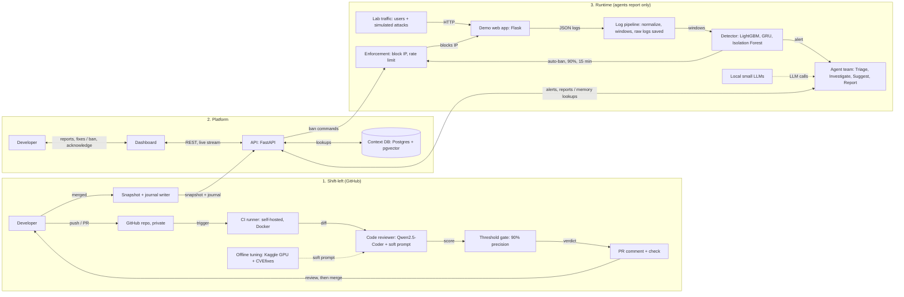

# CyberGuardian — Architecture

This document describes the system at component level. Field-level detail is in `design.md`. The memory layer is specified in `memory.md`.

---

## 1. Big picture

The system has three parts.

1. **Shift-left (lives in GitHub):** reviews code on every PR and writes a snapshot and journal entry on merge.
2. **Platform:** the API, the context database and the dashboard.
3. **Runtime (agentic SOC):** turns logs into alerts, adds an automated investigation, and shows a report to a human.



## 2. Components

### 2.1 Shift-left

| Component | Responsibility | Notes |
|---|---|---|
| GitHub repo | Source of truth for code, PRs and checks | Private. Branch protection requires PRs and the passing check |
| CI runner | Runs the review job | Self-hosted, in a Docker container with no access to the host |
| Code reviewer | Reviews changed Python functions | Qwen2.5-Coder 1.5B plus a soft prompt (7B 4-bit is a stretch result measured on Kaggle) |
| Threshold gate | Converts confidence to pass or fail | Calibrated on validation data to at least 90% precision |
| PR comment + check | Shows the brief and blocks merge on failure | Findings stay here, not in the API |
| Snapshot + journal writer | On merge, extracts the application description and writes a journal entry | Sends both to the API |
| Offline tuning | Trains the soft prompt on CVEfixes | Kaggle free GPU. Output is a small file of vectors copied to the runner |

Merge flow: the developer sees the PR comment and check, then merges (or overrides a failure, which is recorded). The merge triggers the writer.

### 2.2 Platform

| Component | Responsibility |
|---|---|
| API (FastAPI) | Single entry point to the database. Accepts snapshots and journal entries, alerts and reports, notes, ban commands. Serves memory lookups and a live stream |
| Context DB | PostgreSQL with pgvector. Neon in development; a local pgvector container for the demo. Holds snapshots, journal, operational records, knowledge base |
| Dashboard | React (Vite static build). Reports, suggested fixes, ban, acknowledge, notes, snapshot and journal views, admin login |
| Developer | Reads reports, bans or acknowledges, adds decision notes |

### 2.3 Runtime

| Component | Responsibility |
|---|---|
| Lab traffic | Scripts for benign behaviour (logins, browsing, searches) and four attacks: SQL injection, brute force, path traversal, scanning. Stretch: rate-limited flood |
| Demo web app | Flask app that writes JSON logs including `app_version` (commit SHA) |
| Log pipeline | Normalises logs, orders them, saves raw logs as Parquet or JSONL by run ID, builds per-IP and global windows |
| Detector | LightGBM on window features; GRU on the last events of a session (S5b); Isolation Forest for unseen anomalies |
| Agent team | LangGraph: Triage, Investigator, Suggest, Reporter. Report-only |
| Local small LLMs | The soft-tuned Qwen and an untuned small model as baseline |
| Enforcement | Blocks or rate-limits an IP on the demo app. Triggered by the detector (auto-ban) or the API (manual ban) |

## 3. Data flows

### 3.1 Push and merge
1. Developer pushes or opens a PR on GitHub.
2. GitHub triggers the self-hosted runner.
3. Runner extracts changed functions and sends them to the code reviewer.
4. The reviewer returns findings with confidence scores.
5. The gate decides pass or fail. A comment and a check status are posted on the PR.
6. The developer reviews and merges.
7. The snapshot writer extracts structured facts from the merged code, collects the check result, and sends a snapshot and a journal entry to the API.
8. The API stores them in the context DB.

### 3.2 Detection and report
1. Lab traffic hits the demo app. The app logs each request.
2. The pipeline normalises and orders events, stores raw logs, and updates windows.
3. The detector scores windows every second.
4. If the score is at or above the auto-ban threshold, the detector tells Enforcement directly to ban the IP for 15 minutes (unless allowlisted). Unknown-anomaly alerts never auto-ban.
5. The detector sends the alert to the agent team. Triage posts the alert to the API immediately.
6. The Investigator reads surrounding logs and requests memory lookups through the API (by commit SHA and method plus path; vector search for notes and the knowledge base).
7. Suggest proposes a fix and a severity. The Reporter writes the report with memory citations and the auto-ban status.
8. The dashboard shows the alert at step 5 and the full report when it finishes.

### 3.3 Human response
1. Developer opens the report on the dashboard.
2. They either acknowledge it (no action needed) or ban the IP.
3. A ban goes Dashboard → API → Enforcement. Bans expire or can be revoked from the dashboard.
4. Decision notes added in the dashboard are stored in the journal with the author's name and a trust level.

## 4. Trust boundaries

```
Untrusted text:  log fields (URL, user agent, form values), PR titles, commit messages, code comments
        |
        v   always wrapped as data, never as instructions
   Agents (read memory + write report only)
        |
        v   text for humans
   Dashboard  --->  Developer  --->  ban / acknowledge  --->  Enforcement

Numbers only:  detector features and scores  --->  auto-ban (15 min, allowlist)
```

Key points:
- Anything that takes an action is driven either by a number-based ML score (auto-ban) or by a human (manual ban). LLM output is never an action.
- Memory is data. It can inform a report but cannot authorise anything.
- Human-written notes are stored through the dashboard with an author and a trust level.
- The runner executes workflow steps, so the repo is private and the runner is containerised.

## 5. Deployment

Two or three machines, not fixed. A reasonable layout:

| Machine | Runs |
|---|---|
| 16 GB laptop | Self-hosted runner (container), demo app, attack scripts, log pipeline, detector, agents with local LLMs |
| 8 GB laptop | API, local Postgres container (demo), dashboard static build |
| Friend's 16 GB laptop (optional) | Second latency measurement for E3 |
| Kaggle (cloud, free) | Offline soft-prompt tuning only; no live data |
| Neon (cloud, free) | Development database only. The demo uses the local Postgres container |

Everything is a Docker Compose service so it can later move to one server. The lab runs on an isolated Docker network with no exposure to the internet.

## 6. Technology choices

| Layer | Choice |
|---|---|
| Code model | Qwen2.5-Coder (1.5B demo, 7B 4-bit stretch) with soft prompt (PEFT prompt tuning) |
| Code data | CVEfixes (Python subset), deduplicated, split by repository |
| Baselines | Zero-shot Qwen, Semgrep, soft-prompt length variants, LoRA (stretch) |
| Detector | Python, LightGBM, scikit-learn (Isolation Forest), small GRU in PyTorch (S5b) |
| Agents | LangGraph, plain Python tools restricted to memory read and report write |
| LLMs | Local small models via a swappable backend (soft-tuned and untuned) |
| API | FastAPI |
| Database | PostgreSQL + pgvector; Neon for dev, local container for demo |
| Embeddings | A small CPU model such as all-MiniLM-L6-v2 (384 dimensions) |
| Dashboard | React + Vite, static build |
| Files | Parquet or JSONL, partitioned by run ID |
| Orchestration | Docker Compose |

## 7. Failure behaviour

| Failure | Behaviour |
|---|---|
| Agent or LLM is slow or crashes | The alert is already on the dashboard (Triage posts first). The report is marked incomplete. Auto-ban is unaffected because it does not depend on agents |
| API down | Detector still auto-bans via Enforcement. Alerts are queued locally and re-sent |
| Database unavailable | Memory lookups return empty; the report states that memory was unavailable |
| Memory returns nothing for a route | The report says so; the agent does not guess |
| Detector false positive auto-ban | Ban expires after 15 minutes; allowlisted IPs are never banned; a report is still created and can be acknowledged |
| Runner offline | PR check stays pending. Merge is blocked if branch protection requires the check |

## 8. Scalability and limits (honest)

- This is a single-tenant prototype with one app, one runner and one database.
- CPU-only inference makes agents slow. Latency is reported, not hidden.
- Neon free tier limits storage, so logs are files.
- Real distributed attacks and real network-layer DDoS are out of scope.
